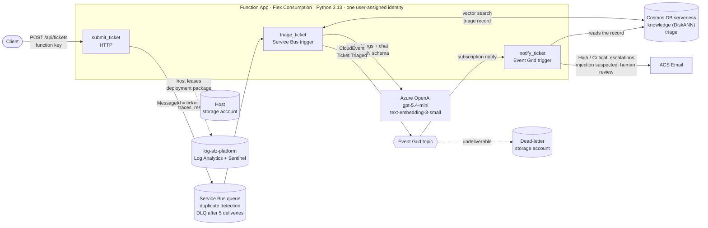

# ticket-triage-agent

Event-driven triage of support tickets for a fictional bank ("Pearl Pay"). A ticket comes in over HTTP, is queued, and a Function classifies it with an LLM grounded in a knowledge base and past tickets (RAG on Cosmos DB vector search). The result is stored, published as an event, and urgent or suspicious tickets are emailed to the right mailbox.

The same code runs locally on emulators and on Azure. On Azure every connection uses a managed identity: there are no keys or connection strings anywhere in the stack.

## Architecture

1. `submit_ticket` validates the request (size caps, no extra fields) and sends it to Service Bus with `MessageId = ticket_id`, so a client retry is dropped by the broker's duplicate detection.
2. `triage_ticket` strips prompt-injection sentences, retrieves similar KB chunks and resolved tickets, and asks the model for one JSON object (category, priority, summary, suggested reply) under a strict schema. Code, not the model, applies the safety rules: fraud wording can't end below `high`, and a ticket flagged for injection can't reach `critical` on the model's word alone.
3. The record is written to Cosmos DB (insert-only, id = ticket id), then a thin `Ticket.Triaged` CloudEvent is published. A failed publish is retried on the Service Bus redelivery.
4. `notify_ticket` reads the record and routes it: injection suspected goes to a human-review mailbox, High/Critical to escalations, everything else sends nothing. The draft reply is never sent to the customer.

| Piece | Local (`docker compose`) | Azure |
|---|---|---|
| Queue | Service Bus emulator 2.0.0 | Service Bus Standard |
| Vectors + records | Cosmos DB vNext emulator | Cosmos DB for NoSQL, serverless, DiskANN |
| Models | Ollama: `phi4-mini`, `nomic-embed-text` | Azure OpenAI: `gpt-5.4-mini`, `text-embedding-3-small` |
| Events | `scripts/eventgrid_stub.py` | Event Grid custom topic, dead-letter to blob |
| Email | Mailpit (SMTP) | Azure Communication Services Email |
| Host storage | Azurite | Storage account (Entra ID only) |
| Auth | emulator keys in gitignored settings | one user-assigned identity, least-privilege data roles |

## Results

| | Local (phi4-mini, CPU) | Azure (gpt-5.4-mini) |
|---|---|---|
| Tuning set (14 tickets): category / priority exact | 100 % / 92.9 % | 100 % / 100 % |
| Critical recall, injection case resisted | 100 %, yes | 100 %, yes |
| Latency p50 | 28 s | 2.2 s |
| Held-out set (8 tickets, never tuned against) | category 87.5 %, priority exact 75 %, critical recall 1 of 2 | not run |

End to end on Azure (2026-11-14): a high-priority ticket produced an escalation email, an injection attempt produced a human-review email, a low-priority ticket produced none; all three with traces and resource logs in the shared Log Analytics workspace. The stack was destroyed the same night. Evidence is in [docs/evidence](docs/evidence).

The held-out set shows the limit of the small local model: an unrecognised-charge ticket came out `high` instead of `critical`, and the injection ticket was mislabelled (still flagged, and the attacker's priority was not applied). Both would still have produced an email.

## Engineering

- **CI, six required checks on `main`:** `lint`, `unit` (117 tests), `integration` (the real emulators, a deterministic fake LLM, Mailpit), `tests-must-fail` (22 known-bad code changes, each must turn the tests red), `iac-static` (Terraform fmt/validate, Checkov, policy unit tests), `iac-plan` (full plan → Conftest gate with 46 rules → 29 plan mutations, each must be denied).
- **Infrastructure:** Terraform, `infra/modules/stack` composes seven modules; `infra/envs/local` plans against the floci-az emulator, `infra/envs/azure` uses remote state and is applied only by CI.
- **Deploys:** GitHub OIDC, no stored cloud credentials. A PR gets a plan; apply and destroy run the exact approved plan after it passes the same policy gate.
- **Security posture:** local auth disabled on Service Bus, Cosmos DB, Event Grid, Azure OpenAI, Communication Services, Application Insights and storage; roles by id at resource scope; Event Grid dead-letters to a storage account of their own; customer text never reaches a mail header or an event payload. Detections for this stack (key listing, federated credentials) live in [kql-threat-detection-lab](https://github.com/salmanamn/kql-threat-detection-lab).

## Run it

Local, with Docker Desktop, uv, Node 22 and Azure Functions Core Tools 4 (set `ACCEPT_EULA=Y` and a password in `.env` first):

    cp .env.example .env && cp src/local.settings.json.example src/local.settings.json
    docker compose --profile ai --profile notify up -d && ./scripts/smoke-local.sh
    docker exec triage-ollama ollama pull nomic-embed-text && docker exec triage-ollama ollama pull phi4-mini:3.8b
    PYTHONPATH=src uv run python scripts/seed_kb.py --create
    ./scripts/eventgrid_stub.py                  # second terminal
    cd src && func start                         # third terminal
    ./scripts/submit_case.py E02 && ./scripts/inbox.py

Azure, for one evening (through CI; needs the identities from [secure-landing-zone](https://github.com/salmanamn/secure-landing-zone)):

    ./scripts/ci-deploy.sh apply && ./scripts/ci-deploy.sh deploy-code && ./scripts/ci-deploy.sh apply --notify
    ./scripts/ci-deploy.sh destroy

## Known limits

- Public endpoints with Entra-only access; no private endpoints or VNet integration (planned for the AKS capstone).
- Email is at-least-once: a crash between send and mark can repeat one email.
- Dead-lettered events and messages are kept, not replayed automatically.
- `scripts/fix-host-storage.sh` works around an azurerm provider bug on Flex Consumption apps (decision D23).

Every design choice with its reason: [docs/decisions.md](docs/decisions.md).